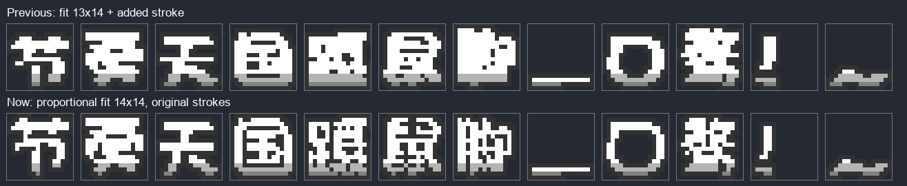
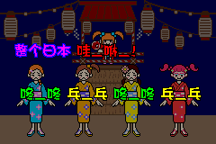
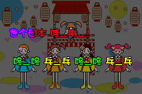

# large 字体取消额外加粗

日期：2026-10-28；分支：`font/text-localization`；开始修改前先同步远程到 `1d53c23f`。

这次按你的新要求修改：**large 不额外加粗，保持字形比例，在 16×16 字格内尽量放大后描边。** 字源仍然是你提供的华康方圆体 W7；W7 自带的笔画粗细保留。

## 为什么改，改了哪里

上次的生成器会把每个字的笔画向右复制一格，所以看起来更粗。为了给这一步留位置，原来的字身最多只能用 13×14 像素。

现在去掉复制笔画这一步，字身可以用到 14×14。四周再各加 1 像素描边，整个字模仍放在 16×16 字格里。汉字按相同比例调整宽和高，描边后的最长边达到 16 像素；例如“一”仍然是扁的，不会被拉成方块。全角标点保留自然比例，小标点不放大。

少数字形缩小时，点采样可能刚好没有取到一个孤立的最外侧像素。生成器会去除新留白，再等比例放大到可用区域。这是整字缩放，不再向笔画旁加点来加粗。

| 文件 | 修改原因 |
| --- | --- |
| `tools/font/build_outline_font.py` | 删除人工加粗；主字源与 Unifont 回退字统一采用 14×14 可用区域；保留左下对齐、完整描边和字底内部阴影。 |
| `tools/font/font_sources.json` | 记录取消人工加粗，以及新的适配上限和比例规则。 |
| `tools/font/test_tengoku_font.py` | 核对全部交付大号字的实际笔画与缩放后的字源一致，防止加粗重新混入；检查汉字最长边达到 16px。 |
| `graphics/font/outline/large/` | 重新生成大号点阵和预览。每字仍为 128 字节，游戏读取方式不变。 |
| `data/font_definitions.c` | 同步生成后的大号字宽，避免文字间距与实际描边宽度不一致。 |

源码修改旁已添加中文注释。小号字模与小号字宽和远程版本逐字节一致，字体定义文件生成区之外也没有变化。现有译文、换行和控制码不需要为了这次字体调整而改写。

## 对比

上排是原先的额外加粗，下排是本次取消额外加粗后的结果。每个框代表完整的 16×16 字格。



## 验证结果

- 重新扫描当前源码，仍为每套 1,312 个字形。大号 1,280 字来自华康，32 字回退到 Unifont；两条路径都不再额外加粗。
- 55 份正文点阵往返检查通过。全部 2,624 个标题字模检查了左下对齐、完整描边、内部阴影、字宽和编码往返；全部大号字身与字源适配结果逐点一致。
- 大号 1,311 个字形发生变化。694 个字模的实际边界是 16×16，其余汉字保留自然比例，最长边为 16px；标点不强行撑满宽高。尺寸统计见 [字模核对记录](qa/large-regular-font-check.json)。
- 测试构建前核对了 5,403 份当前已跟踪文件，包含最新远程的修改。两份测试 ROM 中的大小号字模、字宽和字符索引均与仓库生成结果逐字节相同。
- mGBA 分别跑完盆舞①和②，共 484、504 次歌词对象观察，最长均为 202px，零次超出 240px 画面。正常启动版确认进入标题场景。字节与运行记录见 [ROM 核对记录](qa/large-regular-runtime-check.json)。
- 生成器重复运行后，字模、字宽、字表和预览一致。
- 文本静态检查为0错误、2条提示，分别是录音室歌曲名可能换行、拔毛教程图标适配保留的校对TODO。它们涉及的文本与正文排版不属于本次修改。




本次是测试构建与模拟器验证。由于仍缺少原版 `baserom.gba`，复用了 1,991 份已核对输入相同的图形或音频缓存；远程变化的 45 份图形重新压缩，省略原版尾部填充。它不等同于标准 Makefile 从零构建，也没有进行实体 GBA 验收。

## 重建与试玩

```powershell
python tools/font/build_outline_font.py
python tools/font/test_tengoku_font.py
```

所需字体和依赖的准备方法仍见 [新要求3说明](字库新要求3说明.md)。

本地试玩文件：`build/large_regular/RTChinese-large-regular-20261028.gba`，使用 PLAYTEST PLUS，从正常标题画面启动。
